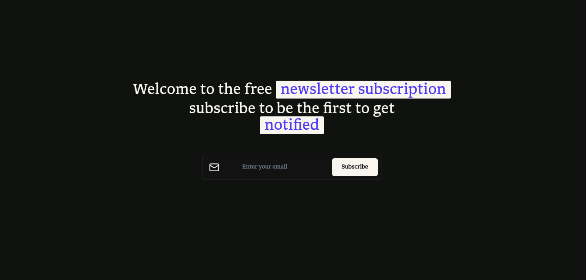

# Newsletter Subscribe

A newsletter signup application with a React frontend and an Express API. The
API stores pending subscriptions in PostgreSQL, sends confirmation email through
Resend, and activates subscribers when they confirm the link.



## Stack

- **Frontend:** React, TypeScript, Vite
- **API:** Node.js, Express, TypeScript
- **Database:** PostgreSQL with Drizzle ORM
- **Email:** Resend
- **Jobs:** Google Cloud Pub/Sub in GCP mode

## Requirements

- Node.js 24 (see `server/.nvmrc` and `web/.nvmrc`)
- pnpm
- Task (go-task), for the combined development command
- A PostgreSQL database
- A Resend account and a verified sender domain for delivery to arbitrary
  recipients

## Local development

Install dependencies in each application:

```bash
cd server && pnpm install
cd ../web && pnpm install
```

Create `server/.env` from `server/.env.example`. Set `DATABASE_URL` to your
PostgreSQL connection string, and set `RESEND_API_KEY` and `RESEND_SENDER` to
your Resend credentials. For local email delivery, Resend's testing sender can
only send to the email address associated with your Resend account. To test
with other recipients, verify a domain in Resend and use a sender on that
domain.

The web app also needs a `web/.env` file:

```env
APP_ENV="development"
APP_PORT="5174"
VITE_APP_API_URL="http://localhost:8080"
```

Run both apps from the repository root:

```bash
task dev
```

The frontend is available at `http://localhost:5174`; the API is available at
`http://localhost:8080`. Wait for both servers to report ready before
submitting the form. The Vite development proxy forwards `/api/*` requests to
the API.

In development, `PUBSUB_MODE` defaults to `local`: the API sends confirmation
emails directly through Resend, without Google Cloud credentials. The local
adapter also sends the welcome email after a successful confirmation.

## Database

Set `DATABASE_URL` in `server/.env`, then apply the checked-in migrations:

```bash
cd server
pnpm run migrate
```

To create a migration after changing the Drizzle schema:

```bash
cd server
pnpm run generate
pnpm run migrate
```

## Tests and checks

Run the server tests and build:

```bash
cd server
pnpm test -- --run
pnpm build
pnpm lint
```

Run frontend checks:

```bash
cd web
pnpm run build
pnpm lint
```

## API routes

The API routes are mounted under `/v1`:

| Method | Path | Purpose |
| --- | --- | --- |
| `GET` | `/v1/healthz` | Health check |
| `POST` | `/v1/newsletter/subscribe` | Create or reissue a subscription confirmation |
| `POST` | `/v1/newsletter/confirm-email` | Confirm a subscriber |
| `POST` | `/v1/newsletter/send-confirm-email` | Pub/Sub push endpoint for confirmation email |
| `POST` | `/v1/newsletter/send-welcome-email` | Pub/Sub push endpoint for welcome email |

## Deploying

The intended hosting layout is the static frontend on Vercel and the Node API
on Render. Configure the API, frontend, database, Resend, and optional Google
Cloud Pub/Sub using each provider's environment-variable settings. Never commit
`.env` files, API keys, or service-account credentials.

### Vercel frontend

Use `web` as the Vercel project root. Set the build command to
`pnpm run build` and the output directory to `dist`. The current frontend calls
the API through relative `/api/...` URLs, so configure a Vercel rewrite from
`/api/:path*` to `https://YOUR-RENDER-SERVICE.onrender.com/v1/:path*`. This
keeps browser requests same-origin and avoids requiring permissive API CORS
configuration. Replace the example hostname with the actual Render service
URL.

### Render API

Use `server` as the Render service root. Set:

- **Build command:** `pnpm install --frozen-lockfile && pnpm run build`
- **Start command:** `pnpm start`

Set `NODE_ENV=production` and configure these variables in Render:

| Variable | Value |
| --- | --- |
| `PORT` | Supplied by Render |
| `DATABASE_URL` | Production PostgreSQL connection string |
| `GCP_PROJECT_ID` | Google Cloud project ID |
| `PUBSUB_MODE` | `gcp` |
| `PUBSUB_VERIFICATION_TOKEN` | Long random secret |
| `APP_URL` | Public Vercel site URL, used in confirmation links |
| `RESEND_API_KEY` | Resend API key |
| `RESEND_SENDER` | Sender address on a domain verified in Resend |

Run database migrations against the production database before accepting
subscriptions.

### Google Cloud Pub/Sub

When `PUBSUB_MODE=gcp`, the API publishes to topic names that include the
`NODE_ENV` suffix. For production, create these topics:

- `newsletter-subscribe-production`
- `newsletter-email-confirmed-production`

Configure push subscriptions to call the Render HTTPS endpoints
`/v1/newsletter/send-confirm-email` and
`/v1/newsletter/send-welcome-email`, respectively. The Render service also needs
Google Application Default Credentials with permission to publish to those
topics.

**Before enabling public Pub/Sub push subscriptions, secure the push
endpoints.** The current handlers do not authenticate incoming Pub/Sub
requests. Also add rate limiting and an unsubscribe endpoint before treating
the application as production-ready for public signups.
